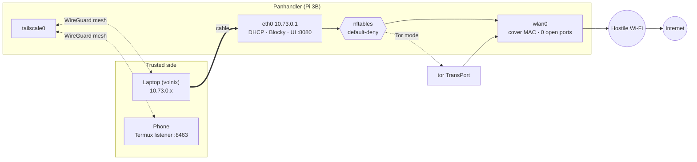
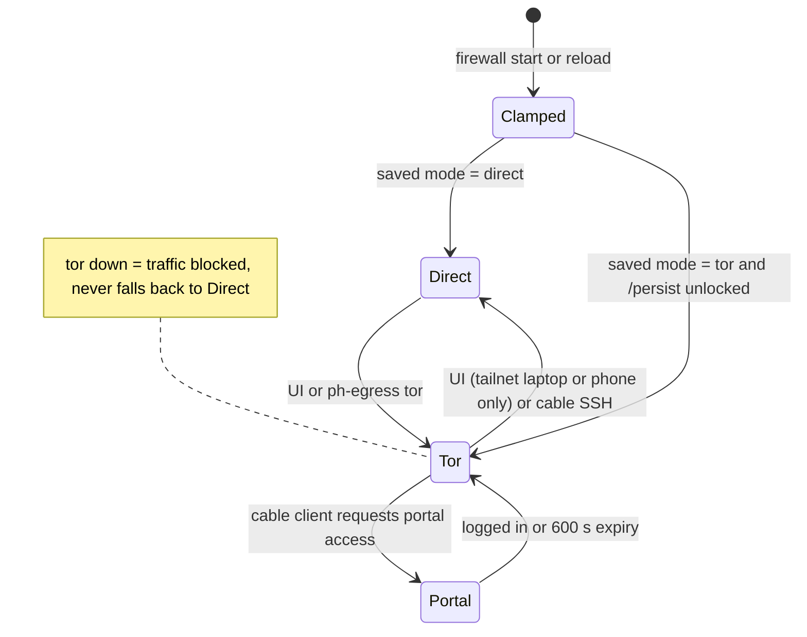
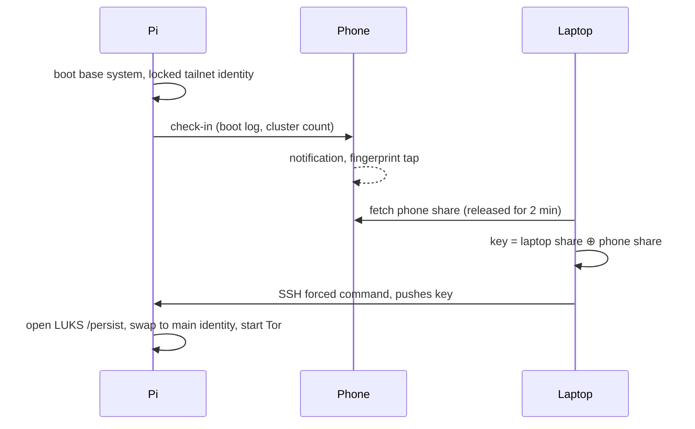

# The Panhandler

[](https://nixos.org)
[](flake.nix)
[](docs/BLUEPRINT.md)
[](flake.nix)
[](pkgs/panhandler-webd/go.mod)
[](pkgs/panhandler-webd/web/package.json)
[](docs/TAILSCALE-POLICY.md)
[](modules/egress.nix)
[](modules/secrets.nix)
[](docs/THREAT-MODEL.md)
[](LICENSE)
[](https://github.com/lowcache/thePanhandler/commits/main)

> **pan·han·dler** /ˈpanˌhandlər/ *noun*
> 1. A person who begs in the street, hand out, asking passers-by for whatever they'll spare.
> 2. A Raspberry Pi that sits on hostile public Wi-Fi with its hand out: it takes whatever the
>    network leaks and gives nothing back. *Pans for gold, handles the dirt.*

A hardened NixOS travel router for hotel, café and airport Wi-Fi. The Pi joins the hostile network,
your laptop plugs into it over Ethernet, and the hostile side sees a forgettable box with no open
ports. Management happens only over the cable or your tailnet.

## What it does today (v1 spine)

| Area | Implementation |
|---|---|
| **Gateway** | Laptop on `eth0` (10.73.0.1/24, DHCP); hotel Wi-Fi on `wlan0`; NAT plus forward filtering ([`gateway.nix`](modules/gateway.nix)) |
| **DNS** | Blocky ad and tracker blocking, DoH upstream to Quad9, bound to the trusted side only |
| **Egress** | **Direct** (default) or **Tor** (transparent proxy, fail-closed, no fallback) ([`egress.nix`](modules/egress.nix)) |
| **Captive portals** | A cable client gets a 600 s window to log in through the Pi's uplink ([`portal.nix`](modules/portal.nix)) |
| **Disguise** | Per-SSID stable MAC, no DHCP hostname, no mDNS, ICMP echo dropped on `wlan0` |
| **At rest** | tmpfs root; secrets in LUKS2 (Adiantum) `/persist`; three independent unlock keyslots |
| **Theft response** | Boot-cluster detection triggers **LOCKDOWN** (unlock over the cable only) |
| **Control plane** | `panhandler-webd`: Go and Svelte UI on `:8080` for Wi-Fi scan, join and forget, egress, portal |
| **Tailnet** | Restricted ACL: a compromised Pi can reach nothing except phone check-ins ([policy](docs/TAILSCALE-POLICY.md)) |

**Roadmap (v2+, not built):** passive network auditor, CertStream sentinel, FOIA watcher,
on-device ML triage, lost-mode beacon, USB Wi-Fi AP. See [`RISKS.md` §2](docs/RISKS.md) for why the
spine comes first.

## How it works

### Topology



### Egress states



### Unlock (device quorum)

`/persist` stays sealed until the laptop and phone agree. The phone share is wrapped by a
hardware-Keystore key that requires a fingerprint.



If the phone records three boots inside its cluster window, or the Pi counts consecutive short
boots, the box enters **LOCKDOWN**: the phone refuses to release its share, and only the passphrase
or Bitwarden slot over the cable will unlock it.

### Storage

| Mount | Encrypted | Holds |
|---|---|---|
| `/` | tmpfs | Everything else, wiped on reboot |
| `/nix`, `/base` | No | Public config, SSH host key, locked tailnet identity, current Wi-Fi only |
| `/persist` | LUKS2 | Main tailnet identity, sops age key, saved Wi-Fi profiles, Tor state |

## Install

**You need:** a Nix host with flakes and `boot.binfmt.emulatedSystems = [ "aarch64-linux" ]`;
`age`, `sops` and `rbw` (Bitwarden); a Pi 3B with a ≥ 32 GB SD card; an Ethernet cable; and an
Android phone with Termux and Termux:API for the quorum share.

```sh
git clone https://github.com/lowcache/thePanhandler && cd thePanhandler
make provision-keys                      # 1. unlock SSH key → keys/unlock-keys.pub
git add keys/unlock-keys.pub             #    flakes ignore untracked files
make image                               # 2. build the SD image (cross-built via binfmt)
make provision-card IMAGE=$TMPDIR/ph-build/sd-image/sd-image/*.img.zst DEVICE=/dev/sdX
                                         # 3. flash, partition, LUKS, split key (destructive, asks first)
make up                                  # 4. cable, wait, unlock, uplink, laptop routes via Pi
```

Adapt the hard-coded values to your setup first: `username` and `panhandler.managementPeers` in
[`flake.nix`](flake.nix), the `PI_*` and `LAPTOP_ETH` addresses in the [`Makefile`](Makefile),
[`.sops.yaml`](.sops.yaml) recipients, and the tailnet policy in [`security/`](security/).
On the phone, run [`phone/enroll.py`](phone/enroll.py) once, then run the listener under
`termux-services` ([`phone/sv/`](phone/sv/)).

## Use

```sh
make            # list every target
make health     # uplink, connectivity, failed units, uptime
make deploy     # build, copy and activate over the cable (VIA=tailnet for remote)
make rollback   # previous generation
make checks     # NixOS VM tests (spine, hardening)
```

| Task | How |
|---|---|
| Join hotel Wi-Fi | UI at `http://10.73.0.1:8080` (cable) or the Pi's MagicDNS name (tailnet) |
| Log in to a captive portal | Cable UI, then **Open portal**, log in, then **End bypass** |
| Switch to Tor or Direct | UI egress control, or `ssh … sudo ph-egress {tor,direct,status}` |
| Laptop keeps its own internet | `make cable-debug`; return with `make cable-share` |
| Measure throughput | `make bench` (run once per egress mode) |

Expect a browsing and email shield, not a streaming VPN. The Pi 3B shares one USB 2.0 bus between
Ethernet and Wi-Fi ([R3](docs/RISKS.md)).

## Docs

[Blueprint](docs/BLUEPRINT.md) · [Threat model](docs/THREAT-MODEL.md) · [Risks](docs/RISKS.md) ·
[Hardening](docs/HARDENING.md) · [Security fixes](docs/SECURITY-FIXES.md) ·
[Tailnet policy](docs/TAILSCALE-POLICY.md) · [Specs and plans](docs/superpowers/)

**Out of scope:** targeted or nation-state attackers, a powered-on seizure, and active scanning of
networks you're a guest on. The Panhandler observes passively and never touches anyone else's
systems ([THREAT-MODEL §2.5](docs/THREAT-MODEL.md)).

[Contributing](CONTRIBUTING.md) · [Security policy](SECURITY.md) · [Code of conduct](CODE_OF_CONDUCT.md) ·
[Sponsors](SPONSORS.md) · [Changelog](CHANGELOG.md) · [MIT License](LICENSE)
