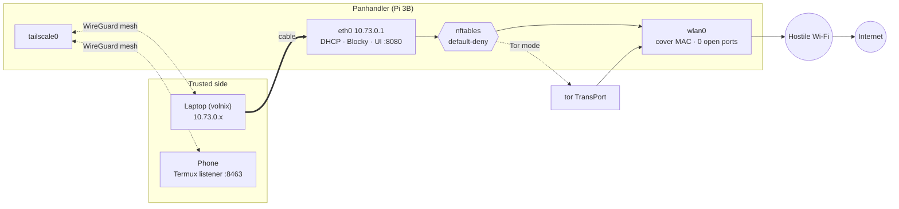
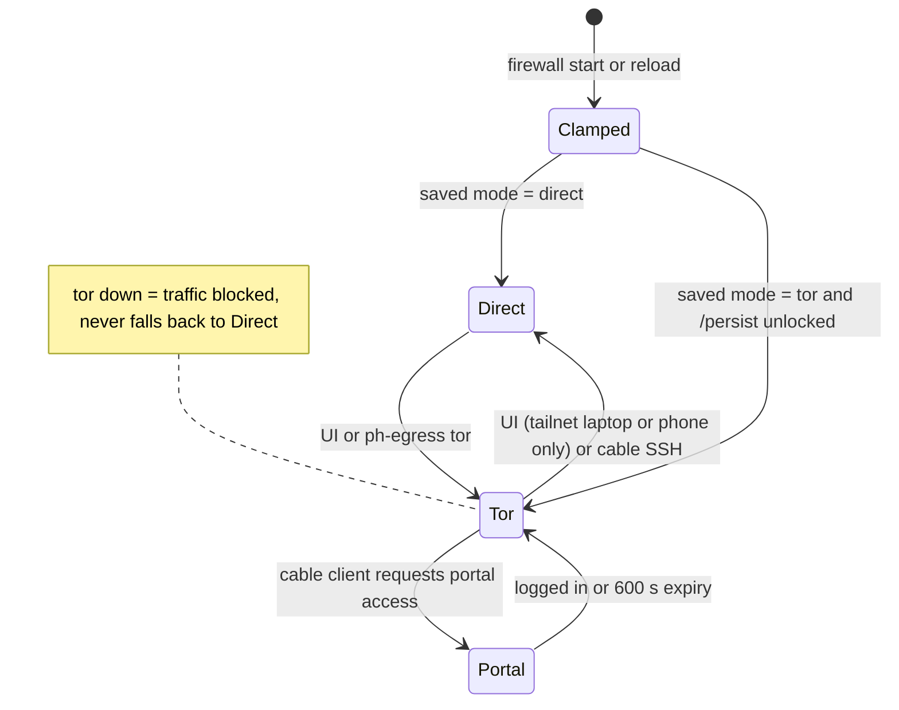
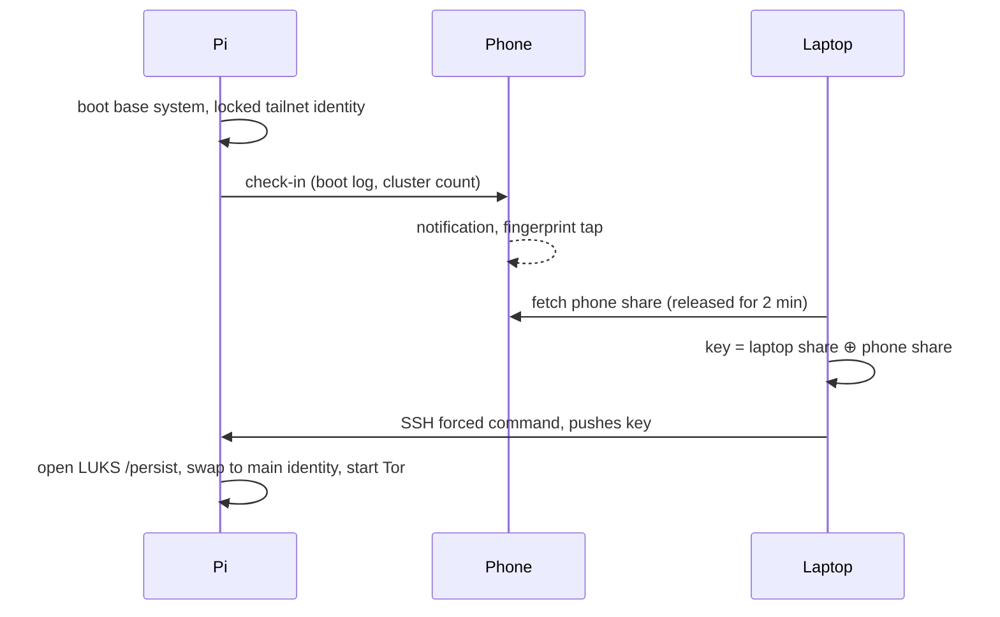

<p align="center">
  
</p>

# The Panhandler

<p align="center">
  <a href="https://components101.com/microcontrollers/raspberry-pi-3-pinout-features-datasheet"></a>
  <a href="https://nixos.org"></a>
  <a href="https://svelte.dev"></a>
  <a href="pkgs/panhandler-webd/go.mod"></a>
  <a href="docs/TAILSCALE-POLICY.md"></a>
  <a href="modules/egress.nix"></a>
  <br>
  <a href="flake.nix"></a>
  <a href="modules/secrets.nix"></a>
  <a href="docs/THREAT-MODEL.md"></a>
  <a href="LICENSE"></a>
  <a href="https://github.com/lowcache/thePanhandler/commits/main"></a>
</p>

---

## Panhandler /ˈpæn.hænd.lə(ɹ)/ noun

1. An urban beggar who typically stands on a street with a homemade cardboard sign  containing either a humorous appeal, a solemn oath, or a sorrowful lamentation. Always accompanied by  an outstretched hand or container for bills & loose change; One who panhandles.
2. A bum, Hobo, Traveler, Crusty, Street Urchin, Squatter, un-housed (in-between residences at the  moment), homeless (one without a home)
3. Grifter.

## So...What is The Panhandler Device?

A Raspberry Pi 3B that flies a cardboard sign on every hostile network while quietly guarding the
devices behind it, managed only from the mesh. The sensor side (its "hobo SOC") is v2. It exists to solve a problem the author actually has: living on rotating
public Wi-Fi where networks are hostile, discovery is off, and captive portals + client isolation
make normal homelab reach impossible.

A panhandler with claim to a busy intersection darts in and out of the flow of traffic gathering
spare change and other forms of charity, defending his claim to the location, and acting as a
silent witness to everything that passes through that single city block. The travel router in this
repo does the same for the small footprint its user occupies on the internet every time they go
online: an unassuming defender for the devices on the user's mesh today, and its watcher and
collector once the v2 sensors land.

One always-on, pocket-sized Linux node with two faces:

- **On the hostile LAN** (hotel/public Wi-Fi): the most forgettable device on the network — a
  per-network MAC, no DHCP hostname, no open ports, no mDNS. A panhandler no one looks at twice.
- **On the tailnet**: `panhandler` — a privacy gateway (and, in v2, a sensor platform) you reach
  from anywhere, through client isolation, with no captive-portal dance.

**Built on:** NixOS (aarch64, cross-built from the laptop) + nixos-hardware + nix modules.


## What it does today (v1 spine)

| Area | Implementation |
|---|---|
| **Gateway** | Laptop on `eth0` (10.73.0.1/24, DHCP); hotel Wi-Fi on `wlan0`; NAT plus forward filtering ([`gateway.nix`](modules/gateway.nix)) |
| **DNS** | Blocky ad and tracker blocking, DoH upstream to Quad9, bound to the trusted side only |
| **Egress** | **Direct** (default) or **Tor** (transparent proxy, fail-closed, no fallback) ([`egress.nix`](modules/egress.nix)) |
| **Captive portals** | A cable client gets a 600 s window to log in through the Pi's uplink ([`portal.nix`](modules/portal.nix)) |
| **Disguise** | Per-SSID stable MAC, no DHCP hostname, no mDNS, ICMP echo dropped on `wlan0` |
| **At rest** | tmpfs root; secrets in LUKS2 (Adiantum) `/persist`; three independent unlock keyslots |
| **Theft response** | Boot-cluster detection triggers **LOCKDOWN** (unlock over the cable only) |
| **Control plane** | `panhandler-webd`: Go and Svelte UI on `:8080` for Wi-Fi scan, join and forget, egress, portal |
| **Tailnet** | Restricted ACL: a compromised Pi can reach nothing except phone check-ins ([policy](docs/TAILSCALE-POLICY.md)) |

**Roadmap (v2+, not built):** passive network auditor, CertStream sentinel, FOIA watcher,
on-device ML triage, slot-machine dApp fairness watchdog, lost-mode beacon, USB Wi-Fi AP. The
contracts the watchdog will watch (CryptoSpin on Solana/Rust, and a Solidity slot) are audited as
separate projects ([BLUEPRINT §7](docs/BLUEPRINT.md)). See [`RISKS.md` §2](docs/RISKS.md) for why the
spine comes first.

## How it works

### Topology



### Egress states



### Unlock (device quorum)

`/persist` stays sealed until the laptop and phone agree. The phone share is wrapped by a
hardware-Keystore key that requires a fingerprint.



If the phone records three boots inside its cluster window, or the Pi counts consecutive short
boots, the box enters **LOCKDOWN**: the phone refuses to release its share, and only the passphrase
or Bitwarden slot over the cable will unlock it.

### Storage

| Mount | Encrypted | Holds |
|---|---|---|
| `/` | tmpfs | Everything else, wiped on reboot |
| `/nix`, `/base` | No | Public config, SSH host key, locked tailnet identity, current Wi-Fi only |
| `/persist` | LUKS2 | Main tailnet identity, sops age key, saved Wi-Fi profiles, Tor state |

## Install

**You need:** a Nix host with flakes and `boot.binfmt.emulatedSystems = [ "aarch64-linux" ]`;
`age`, `sops` and `rbw` (Bitwarden); a Pi 3B with a ≥ 32 GB SD card; an Ethernet cable; and an
Android phone with Termux and Termux:API for the quorum share.

```sh
git clone https://github.com/lowcache/thePanhandler && cd thePanhandler
make provision-keys                      # 1. unlock SSH key → keys/unlock-keys.pub
git add keys/unlock-keys.pub             #    flakes ignore untracked files
make image                               # 2. build the SD image (cross-built via binfmt)
make provision-card IMAGE=$TMPDIR/ph-build/sd-image/sd-image/*.img.zst DEVICE=/dev/sdX
                                         # 3. flash, partition, LUKS, split key (destructive, asks first)
make up                                  # 4. cable, wait, unlock, uplink, laptop routes via Pi
```

Adapt the hard-coded values to your setup first: `username` and `panhandler.managementPeers` in
[`flake.nix`](flake.nix), the `PI_*` and `LAPTOP_ETH` addresses in the [`Makefile`](Makefile),
[`.sops.yaml`](.sops.yaml) recipients, and the tailnet policy in [`security/`](security/).
On the phone, run [`phone/enroll.py`](phone/enroll.py) once, then run the listener under
`termux-services` ([`phone/sv/`](phone/sv/)).

## Use

```sh
make            # list every target
make health     # uplink, connectivity, failed units, uptime
make deploy     # build, copy and activate over the cable (VIA=tailnet for remote)
make rollback   # previous generation
make checks     # NixOS VM tests (spine, hardening)
```

| Task | How |
|---|---|
| Join hotel Wi-Fi | UI at `http://10.73.0.1:8080` (cable) or the Pi's MagicDNS name (tailnet) |
| Log in to a captive portal | Cable UI, then **Open portal**, log in, then **End bypass** |
| Switch to Tor or Direct | UI egress control, or `ssh … sudo ph-egress {tor,direct,status}` |
| Laptop keeps its own internet | `make cable-debug`; return with `make cable-share` |
| Measure throughput | `make bench` (run once per egress mode) |

Expect a browsing and email shield, not a streaming VPN. The Pi 3B shares one USB 2.0 bus between
Ethernet and Wi-Fi ([R3](docs/RISKS.md)).

## Docs

[Blueprint](docs/BLUEPRINT.md) · [Threat model](docs/THREAT-MODEL.md) · [Risks](docs/RISKS.md) ·
[Hardening](docs/HARDENING.md) · [Security fixes](docs/SECURITY-FIXES.md) ·
[Tailnet policy](docs/TAILSCALE-POLICY.md) · [Specs and plans](docs/superpowers/)

**Out of scope:** targeted or nation-state attackers, a powered-on seizure, and active scanning of
networks you're a guest on. The Panhandler observes passively and never touches anyone else's
systems ([THREAT-MODEL §2.5](docs/THREAT-MODEL.md)).

[Contributing](CONTRIBUTING.md) · [Security policy](SECURITY.md) · [Code of conduct](CODE_OF_CONDUCT.md) ·
[Sponsors](SPONSORS.md) · [Changelog](CHANGELOG.md) · [MIT License](LICENSE)
