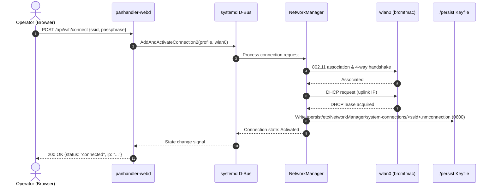
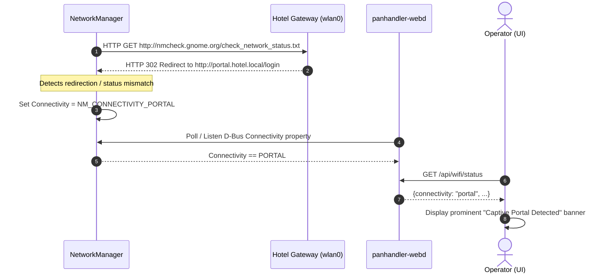

# Dynamic Wi-Fi Management & Web Admin UI (Design)

**Date:** 2026-10-18 · **Status:** approved in design pass, pending implementation
**Maps to:** THREAT-MODEL A2, A3, A5; RISKS R2, R4; BLUEPRINT §1, §2.A, §3, §4.

## 0. Context and current state

thePanhandler is a hardened travel router and passive sensing node built on a Raspberry Pi 3B (aarch64-linux, 1 GB RAM, single Broadcom BCM43430 Wi-Fi radio on `brcmfmac`, mainline kernel). It runs a standalone NixOS flake (nixpkgs 26.11) with a tmpfs root (`size=256M`) and impermanence backed by an encrypted LUKS2 `/persist` partition unlocked in stage 2 (`ph-persist.target`).

The gateway data plane is live and verified:
- **Downlink (`eth0`):** static `10.73.0.1/24`, serving DHCP via `dnsmasq` (`10.73.0.50`–`150`) to the tethered laptop.
- **DNS resolver:** `blocky` listening on `10.73.0.1:53`, upstreaming encrypted DoH to Quad9 (`https://dns.quad9.net/dns-query`, bootstrap `9.9.9.9`).
- **NAT & routing:** `networking.nftables.enable = true` with `networking.nat` masquerading `eth0 -> wlan0` and `ip_forward` enabled.
- **Uplink (`wlan0`):** managed by `wpa_supplicant` via `networking.wireless`.
- **Management:** accessible over `tailscale0` (100.81.123.86; dynamic — the node re-auths) and the `eth0` link-local/static cable.

Today, Wi-Fi networks and credentials are hardcoded in `modules/wifi.nix` (e.g., `ESAconnect`, `VolatileDevice`). This embeds SSIDs into the world-readable `/nix/store` and public Git commits.

## 1. Problem

The user re-homes to new Wi-Fi networks ~twice a week (hotels, coworking spaces, coffee shops, transit hubs).

Hardcoding SSIDs in declarative Nix configuration fails operationally:
1. **Rebuild latency:** evaluating a NixOS generation, copying closures across the link, and switching configurations on a 1 GB Pi 3B takes minutes per network join.
2. **Information disclosure (OPSEC failure):** hardcoded SSIDs land in `/nix/store` and public Git history, creating an indelible, public location trail of the author's movements.
3. **No ad-hoc join capability:** connecting to an unfamiliar network requires an existing internet connection to pull or build the updated Nix closure.

Wi-Fi network selection and credential entry must become **runtime mutable state**, driven by an on-device web UI with zero Nix rebuilds.

## 2. Goals and non-goals

### Goals
- **Dynamic Wi-Fi lifecycle:** live scanning, connection, disconnection, profile deletion ("forget"), signal strength monitoring, and uplink status tracking without Nix rebuilds.
- **Secret isolation:** WPA-PSK passphrases entered via the UI are handled server-side and stored exclusively in encrypted `/persist`, never emitted to `/nix/store`, and never logged.
- **Downlink client viewport:** table of downstream devices populated from `dnsmasq` DHCP leases and ARP/neighbor tables (MAC, IP, hostname, OUI vendor).
- **Diagnostic log streaming:** live tail of relevant systemd units (`panhandler-webd`, `NetworkManager`, `dnsmasq`, `blocky`) streamed via Server-Sent Events (SSE).
- **Captive portal detection:** surface network connectivity state (`full`, `portal`, `limited`, `none`) directly in the UI.
- **Interface polish:** responsive, token-based design system achieving blog-level aesthetic quality; laptop-first, fully usable down to mobile (Android).

### Non-goals (separate tracks)
- **Downlink AP module:** hosting an access point via a secondary USB Wi-Fi dongle (`hostapd`) for wireless devices (Roku/phones) is a separate track.
- **Egress tunnel selector:** switching routes between direct, Tor anon-box, and Tailscale exit nodes is a separate track.
- **Stealth and cloaking controls:** per-SSID MAC randomization, hostname cloaking, and passive auditor sensor controls are separate tracks.
- **Captive portal proxy automation:** the full interactive proxy-auth flow is Phase C; this spec defines the detection hook and architecture, not the Phase C proxy implementation.

## 3. Decisions & architecture

### Architectural decisions

| # | Decision | Rationale | Supersedes |
|---|---|---|---|
| D1 | Replace `wpa_supplicant` with `NetworkManager` on `wlan0`. | NetworkManager natively manages runtime Wi-Fi lifecycle, auto-reconnect, secret storage, and connectivity checking. | `networking.wireless` in `modules/wifi.nix` |
| D2 | `panhandler-webd` control daemon written in Go. | Single static aarch64 binary, zero runtime dependencies, low memory footprint (<30 MB RSS on 1 GB RAM). | Shell-scripted API / external web servers |
| D3 | Control NetworkManager via system D-Bus. | Robust, structured IPC over `org.freedesktop.NetworkManager`; avoids fragile CLI scraping of `nmcli`. | Invoking CLI tools via child processes |
| D4 | Strict interface binding. | Daemon binds ONLY trusted interfaces (`tailscale0` and `eth0`). NEVER binds `wlan0`. | Binding `0.0.0.0` with firewall filtering |
| D5 | No application-level authentication in Phase A. | Daemon is unreachable from the hostile uplink; trust boundary is enforced at the network layer (Tailscale + physical wire). | Complex JWT/session auth in MVP |
| D6 | Persist connection profiles in `/persist`. | Network profiles and secrets persist across reboots in encrypted storage; `/` remains tmpfs. | Ephemeral configs or Nix store storage |
| D7 | Frontend implemented as a compiled Svelte SPA. | Zero-runtime-overhead compiled JavaScript, reactive state stores, tiny bundle size; embedded in Go binary via `embed.FS`. | Server-rendered templates or heavy frameworks |

### Architecture diagram

```
┌────────────────────────────────────────────────────────────────────────┐
│ HOSTILE LAN (wlan0)                                                    │
│  - No listening ports (default-deny firewall)                          │
│  - NetworkManager manages association, scanning, DHCP client           │
└───────────────────────────────────▲────────────────────────────────────┘
                                    │ wlan0
┌───────────────────────────────────┴────────────────────────────────────┐
│ thePanhandler (Raspberry Pi 3B)                                        │
│                                                                        │
│   ┌────────────────────────────────────────────────────────────────┐   │
│   │ NetworkManager (systemd)                                       │   │
│   │   - D-Bus: org.freedesktop.NetworkManager                      │   │
│   │   - Profiles: /persist/etc/NetworkManager/system-connections/  │   │
│   └────────────────▲───────────────────────────────────────────────┘   │
│                    │ D-Bus IPC                                         │
│   ┌────────────────┴───────────────────────────────────────────────┐   │
│   │ panhandler-webd (Go daemon, hardened unit)                     │   │
│   │   - JSON REST API + SSE log/event streaming                    │   │
│   │   - Embeds compiled Svelte SPA (embed.FS)                      │   │
│   │   - Inspects /var/lib/dnsmasq/dnsmasq.leases + /proc/net/arp   │   │
│   └────────────────▲───────────────────────────────▲───────────────┘   │
│                    │                               │                   │
│                    │ :8080                         │ :8080             │
└────────────────────┼───────────────────────────────┼───────────────────┘
                     │ eth0 (static 10.73.0.1)       │ tailscale0 (mesh)
                     ▼                               ▼
       ┌───────────────────────────┐   ┌───────────────────────────┐
       │ Tethered Laptop (Cable)   │   │ Trusted Phone / Laptop    │
       │ Browser (Svelte SPA)      │   │ Browser (Tailscale Mesh)  │
       └───────────────────────────┘   └───────────────────────────┘
```

## 4. Components

### 4.1. Control daemon: `panhandler-webd`
- **Language & packaging:** written in standard Go, compiled as a static aarch64 binary, packaged via Nix Flake (`packages.aarch64-linux.panhandler-webd`).
- **HTTP server:** uses standard library `net/http` listening explicitly on `10.73.0.1:8080` and `tailscale0` IP:8080.
- **NetworkManager D-Bus client:** connects to the system bus via `github.com/godbus/dbus/v5`:
  - `org.freedesktop.NetworkManager.RequestScan`
  - `org.freedesktop.NetworkManager.GetAccessPoints`
  - `org.freedesktop.NetworkManager.AddAndActivateConnection2`
  - `org.freedesktop.NetworkManager.DeactivateConnection`
  - Property change signals for active connection and connectivity state.
- **Device & lease inspector:**
  - Reads DHCP leases from `/var/lib/dnsmasq/dnsmasq.leases` (`<timestamp> <mac> <ip> <hostname> <client-id>`).
  - Reads active ARP table from `/proc/net/arp` and kernel neighbor table via netlink.
  - Matches MAC addresses against an embedded compressed IEEE OUI prefix table for hardware vendor resolution.
- **Log streaming engine:**
  - Tails systemd journal for specific units (`panhandler-webd.service`, `NetworkManager.service`, `dnsmasq.service`, `blocky.service`).
  - Streams newline-delimited JSON objects over an HTTP Server-Sent Events (SSE) connection (`Content-Type: text/event-stream`).
- **Static asset server:**
  - Serves compiled frontend assets embedded via Go's `//go:embed dist/*`.
  - Implements SPA fallback routing (serves `index.html` for non-API client routes).

### 4.2. NetworkManager backend
- **NixOS module configuration:** `networking.networkmanager.enable = true`.
- **Interface management policy:**
  - NM is strictly configured to manage `wlan0` only.
  - Downlink (`eth0`) and mesh (`tailscale0`) are explicitly marked unmanaged:
    ```ini
    # /etc/NetworkManager/conf.d/99-unmanaged.conf
    [keyfile]
    unmanaged-devices=interface-name:eth0;interface-name:tailscale0
    ```
- **Driver workarounds preserved:**
  - Wi-Fi power save disabled to prevent BCM43430 4-way handshake timeouts:
    ```ini
    [connection]
    wifi.powersave = 2
    ```
  - **Regulatory domain is a kernel setting, not an NM one.** With `wpa_supplicant` (and its `country=US`) removed, set it declaratively via the cfg80211 module parameter so cfg80211 initializes the channel map before association:
    ```nix
    boot.extraModprobeConfig = ''options cfg80211 ieee80211_regdom="US"'';
    ```
    (Verified: `cfg80211` exposes `ieee80211_regdom` as a `charp` param. NM has no option that sets the kernel regdomain.)
- **Connectivity check:** configured to probe HTTP endpoint (e.g., `http://nmcheck.gnome.org/check_network_status.txt`) to determine captive portal status.

### 4.3. Frontend: Svelte SPA
- **Structure:** single-page application built with Svelte and Vite; compiled into static HTML/CSS/JS with zero runtime framework overhead.
- **Design system:** token-based CSS adhering to the project's aesthetic standards:
  - Deep dark background palette (`#0d1117`, `#161b22`, `#21262d`).
  - High-contrast, functional typography using system monospace and sans-serif fonts.
  - Compact, high-information-density layout suitable for operations.
  - Responsive breakpoints adapting smoothly from 1920px laptop monitors down to 360px mobile viewports.
- **Panels & views:**
  1. **Wi-Fi Manager:** live AP scan table (SSID, signal bars/dBm, security type [Open, WPA2, WPA3], active indicator), join modal with passphrase input, forget action, and uplink status card.
  2. **Device Viewport:** table of downstream devices on `eth0` (IP, MAC, Hostname, OUI Vendor, Lease Expiry).
  3. **Live Logs:** streaming terminal pane displaying journald logs with unit filter pills and auto-scroll controls.
  4. **Captive Portal Banner:** prominent status banner appearing when NM detects captive portal interception.

## 5. API surface

### Endpoints

| Method | Path | Format | Description |
|---|---|---|---|
| `GET` | `/api/wifi/scan` | JSON | Trigger or fetch cached Wi-Fi scan results. |
| `POST` | `/api/wifi/connect` | JSON | Connect to an SSID with optional passphrase. |
| `POST` | `/api/wifi/forget` | JSON | Delete a saved Wi-Fi connection profile. |
| `GET` | `/api/wifi/status` | JSON | Current uplink status, signal, IP, and portal state. |
| `GET` | `/api/devices` | JSON | Active downstream DHCP leases and ARP neighbors. |
| `GET` | `/api/logs` | SSE | Real-time stream of system journal entries. |
| `POST` | `/api/wifi/portal/authorize` | JSON | Hook for Phase C captive-portal proxy activation. |

### Schemas

#### `GET /api/wifi/scan`
Response:
```json
[
  {
    "ssid": "Hotel-Guest",
    "bssid": "aa:bb:cc:dd:ee:ff",
    "signal": 78,
    "security": "wpa2-psk",
    "inUse": false
  },
  {
    "ssid": "CoffeeShop-Open",
    "bssid": "11:22:33:44:55:66",
    "signal": 92,
    "security": "open",
    "inUse": true
  }
]
```

#### `POST /api/wifi/connect`
Request:
```json
{
  "ssid": "Hotel-Guest",
  "passphrase": "SecretPassword123"
}
```
Response:
```json
{
  "status": "connected",
  "ssid": "Hotel-Guest",
  "ip": "192.168.1.145"
}
```
*Note: Passphrases are processed in memory and written directly to NetworkManager via D-Bus; they are never reflected in response payloads.*

#### `POST /api/wifi/forget`
Request:
```json
{
  "ssid": "Hotel-Guest"
}
```
Response:
```json
{
  "status": "forgotten",
  "ssid": "Hotel-Guest"
}
```

#### `GET /api/wifi/status`
Response:
```json
{
  "connected": true,
  "uplinkSsid": "Hotel-Guest",
  "bssid": "aa:bb:cc:dd:ee:ff",
  "ip": "192.168.1.145",
  "signal": 78,
  "connectivity": "portal"
}
```
*`connectivity` values:* `"full"` (internet verified), `"portal"` (captive portal detected), `"limited"` (connected, no internet route), `"none"` (disconnected).

#### `GET /api/devices`
Response:
```json
[
  {
    "mac": "50:eb:f6:12:34:56",
    "ip": "10.73.0.52",
    "hostname": "volnix-laptop",
    "vendor": "Framework Computer Inc.",
    "leaseExpires": "2026-10-19T14:32:00Z"
  }
]
```

#### `GET /api/logs` (SSE stream)
Event stream payload:
```
event: log
data: {"unit":"NetworkManager","timestamp":"2026-10-18T22:30:12Z","priority":"info","message":"<info> [1729290612.123] device (wlan0): state change: config -> ip-config"}

event: log
data: {"unit":"blocky","timestamp":"2026-10-18T22:30:13Z","priority":"info","message":"query 10.73.0.52: captive.apple.com -> blocked: false (0.012s)"}
```

## 6. Data flow

### 6.1. Network scan and association flow


### 6.2. Captive portal detection flow


### 6.3. Downlink device discovery flow
```
Client DHCP Request ──▶ dnsmasq ──▶ Writes /var/lib/dnsmasq/dnsmasq.leases
                                         │
                                         ▼
Operator Browser ──▶ GET /api/devices ──▶ panhandler-webd
                                         │
                                         ├─▶ Reads dnsmasq.leases (IP, MAC, hostname, expiry)
                                         ├─▶ Reads /proc/net/arp (verifies active L2 neighbors)
                                         └─▶ Resolves OUI prefix via embedded vendor map
                                         │
                                         ▼
                     Returns JSON ◀──────┘
```

## 7. State & impermanence

### Persisted state (`/persist`)
Under the storage spine, `/` is an ephemeral tmpfs wiped on reboot. All persistent NetworkManager state must reside on the encrypted LUKS `/persist` partition.

Required persistent paths — declared through the nix-community `impermanence` flake the storage spine already uses (consistent with its enumerated state dirs), not ad-hoc mounts:
- `/persist/etc/NetworkManager/system-connections/` bind-mounted to `/etc/NetworkManager/system-connections/`:
  - Contains `.nmconnection` keyfiles.
  - Permissions: directory `0700 root:root`, keyfiles `0600 root:root`.
  - Holds network SSIDs, auto-connect priorities, and WPA-PSK passphrases.
- `/persist/var/lib/NetworkManager/` bind-mounted to `/var/lib/NetworkManager/`:
  - Stores NetworkManager internal state, timestamps, seen BSSIDs, and DHCP client DUIDs.

### Ephemeral state (tmpfs / memory)
The following state is intentionally ephemeral and discarded on poweroff:
- `/var/lib/dnsmasq/dnsmasq.leases`: dynamic DHCP leases granted to downstream clients; reconstructed automatically when clients renew.
- `/run/NetworkManager/`: runtime control sockets, active connection state objects, and generated resolv.conf files.
- `/run/panhandler-webd/`: daemon runtime sockets and PID file.
- Daemon process memory: passphrases parsed from HTTP request bodies exist only transiently in memory while issuing D-Bus calls, then are garbage collected.

### Secret lifecycle
1. **Ingress:** Passphrase entered into browser input field (`type="password"`).
2. **Transport:** Transmitted over authenticated channels (`tailscale0` WireGuard tunnel or point-to-point Ethernet cable `eth0`).
3. **Receipt:** `panhandler-webd` deserializes the JSON payload.
4. **Handoff:** Daemon immediately constructs the D-Bus dictionary and passes the secret to NetworkManager via `AddAndActivateConnection2`.
5. **Persistence:** NetworkManager writes the secret into `/persist/etc/NetworkManager/system-connections/<ssid>.nmconnection` with mode `0600`.
6. **Purge:** Request buffer is released; passphrases are never written to standard logs, journald, or query traces.

## 8. Security & threat-model mapping

| Threat Actor | Threat Vector | Mitigation in this Design |
|---|---|---|
| **A0: Physical Thief** | Pi stolen while powered off; SD card examined for credentials. | Profiles and PSKs reside exclusively in `/persist` (LUKS2 Adiantum encrypted). Root tmpfs leaves no trace of Wi-Fi credentials in `/base` or the SD card image. |
| **A2: Captive Portal / Hotel ISP** | Attacker on hostile uplink probes Pi for open management ports or web UIs. | `panhandler-webd` binds strictly to `10.73.0.1` (`eth0`) and `tailscale0`. Firewall enforces default-deny on `wlan0`. Port 8080 is completely closed and dropped on the hostile uplink. |
| **A3: Passive LAN Sniffer** | Sniffer intercepts management traffic or Wi-Fi credentials. | UI is accessible only over encrypted Tailscale mesh or physical copper Ethernet cable. Management traffic never traverses `wlan0`. |
| **A5: Compromised Box** | Attacker compromises web daemon or parses untrusted input. | SSIDs and PSKs are removed from the Nix store. Daemon runs as a dedicated system user with strict systemd sandboxing. Input validation prevents injection into D-Bus or config files. |

### Systemd service hardening: `panhandler-webd.service`

`DynamicUser=true` cannot be used because the daemon requires access to system D-Bus policies for NetworkManager and read access to `/var/lib/dnsmasq/dnsmasq.leases`. Instead, a dedicated system user is used with rigorous capability dropping and isolation:

```ini
[Unit]
Description=thePanhandler Web Management Daemon
After=network.target NetworkManager.service
Requires=NetworkManager.service

[Service]
Type=exec
User=panhandler-webd
Group=panhandler-webd
ExecStart=/run/current-system/sw/bin/panhandler-webd \
  --listen-eth 10.73.0.1:8080 \
  --listen-tailscale auto:8080

# Hardening
CapabilityBoundingSet=
AmbientCapabilities=
NoNewPrivileges=true
ProtectSystem=strict
ProtectHome=true
PrivateTmp=true
ProtectKernelTunables=true
ProtectKernelModules=true
ProtectControlGroups=true
MemoryMax=64M
CPUQuota=50%
ReadOnlyPaths=/var/lib/dnsmasq/dnsmasq.leases /proc/net/arp
RestrictAddressFamilies=AF_UNIX AF_INET AF_INET6 AF_NETLINK
RestrictRealtime=true
LockPersonality=true
```

### Input validation
- **SSID:** length constrained to 1–32 octets; null bytes and illegal control characters rejected.
- **Passphrase:** 8–63 ASCII characters for WPA2-PSK (or 64 hexadecimal characters); verified before dispatching to D-Bus.

## 9. Phasing

### Phase A: Core Dynamic Wi-Fi (MVP)
- **Deliverable:** complete dynamic Wi-Fi scan, connect, forget, and status functionality via `panhandler-webd` and Svelte UI.
- **Scope:**
  - NixOS module migrating `wlan0` to NetworkManager while preserving `eth0` and `tailscale0`.
  - Implementation of `panhandler-webd` Go daemon with D-Bus integration.
  - Implementation of Svelte SPA with Wi-Fi management panel, signal indicators, and token design system.
  - Packaging via Nix flake.
- **Outcome:** user can join hotel/public Wi-Fi without rebuilding or deploying Nix closures.

### Phase B: Downlink Observability & Logs
- **Deliverable:** downstream client viewport and live journald log viewer in the web UI.
- **Scope:**
  - Parsing `dnsmasq.leases` and `/proc/net/arp` in `panhandler-webd`.
  - Embedded IEEE OUI vendor database.
  - SSE endpoint streaming journal logs for `panhandler-webd`, `NetworkManager`, `dnsmasq`, and `blocky`.
  - Svelte UI panels for device tables and streaming log terminal.
- **Outcome:** real-time visibility into tethered devices and network subsystem health.

### Phase C: Captive Portal Proxy Authorization
- **Deliverable:** captive portal detection and automated proxy flow.
- **Scope:**
  - Surfacing captive portal detection directly from NetworkManager connectivity state.
  - Implementing the portal-proxy mechanism over the cable (RISKS R2): tethered laptop browser navigates through the Pi's uplink to complete authentication.
  - **DNS chicken-and-egg resolution:** pre-auth captive portals block upstream encrypted DoH (`https://dns.quad9.net/dns-query`); Phase C introduces a temporary plaintext-DNS bypass to the DHCP-provided gateway resolver while in `connectivity: portal` state, immediately locking back down to strict Quad9 DoH once `connectivity: full` is attained.
- **Outcome:** seamless headless captive portal authorization.

### Future / separate tracks
- **Track 1 (Wireless AP Serving):** hostapd configuration on a secondary USB Wi-Fi adapter to serve phones/Rokus over Wi-Fi.
- **Track 2 (Egress Routing & Kill-switch):** nftables routing rules to dynamically toggle egress between direct, Tor anon-box, and Tailscale exit nodes.
- **Track 3 (Stealth & Sensors):** MAC address cloaking, cover hostname rotation, and passive HTTP/DNS auditor sensor integration.

## 10. Migration plan & risks

### Migration execution steps
1. **Preserve Ethernet lifeline:** verify `modules/gateway.nix` continues to configure `eth0` with static IP `10.73.0.1/24` and `dnsmasq`. Never place `eth0` under NetworkManager control.
2. **Configure NetworkManager in NixOS:**
   - Enable `networking.networkmanager.enable = true`.
   - Disable `networking.wireless.enable = false` to remove `wpa_supplicant`.
   - Apply unmanaged device rules for `eth0` and `tailscale0`.
   - Configure Wi-Fi powersave disable (`wifi.powersave = 2`).
   - Set the regulatory domain at the **kernel** level via `boot.extraModprobeConfig` (`options cfg80211 ieee80211_regdom="US"`) — NM does not set it. This replaces the removed `wpa_supplicant` `country=US`.
3. **Bind `/persist` directories:** ensure `/persist/etc/NetworkManager/system-connections` exists with `0700` permissions before NetworkManager starts.
4. **Deploy `panhandler-webd`:** install and start the systemd unit.
5. **Verify live cutover:** connect via Ethernet cable; verify SSH and web UI access on `10.73.0.1:8080`; perform initial Wi-Fi scan and join via UI.

### Risks and mitigations

| Risk | Impact | Mitigation |
|---|---|---|
| **Loss of uplink drops management** | Severe (loss of remote access over Tailscale). | Ethernet cable lifeline (`eth0`) is unmanaged and statically bound; management over copper cable is completely immune to Wi-Fi cutover issues. |
| **NetworkManager hijacks `eth0`** | High (downlink subnet and DHCP disrupted). | Explicit `unmanaged-devices=interface-name:eth0` directive in NetworkManager configuration. |
| **BCM43430 Wi-Fi power-save flap** | High (link drops during 4-way handshake). | Configure `wifi.powersave = 2` in NM configuration; retain `wlan0-powersave-off` oneshot service as backstop. |
| **Regulatory domain scan failure** | High (scan fails with error -512 / escan_timeout). | Set `country=US` at the **kernel** level via `boot.extraModprobeConfig` (`options cfg80211 ieee80211_regdom="US"`); NM does not set the regdomain. |
| **`ph-checkin.sh` breakage** | Medium (check-in script fails if expecting `wpa_cli`). | Update `ph-checkin.sh` to query NetworkManager (`nmcli` or reading active connection state) instead of invoking `wpa_cli`. |

## 11. Open questions and [VERIFY] list

- `[VERIFY]` **D-Bus permissions for non-root user:** verify the exact D-Bus XML policy required to allow the `panhandler-webd` system user to invoke `AddAndActivateConnection2` and `DeactivateConnection` without Polkit prompting.
- `[VERIFY]` **NixOS 26.11 NetworkManager module interactions:** confirm whether `networking.wireless.enable = false` cleanly terminates all `wpa_supplicant` services and prevent socket conflicts on `wlan0`.
- `[VERIFY]` **Svelte asset compilation in Flake:** verify whether the frontend is built using `buildNpmPackage` under binfmt on volnix or if pre-built static assets are checked into the repository to avoid Node.js build overhead during aarch64 image evaluation.
- `[VERIFY]` **Blocky DNS bootstrap during portal state:** verify whether NetworkManager's connectivity probe URL can be resolved when captive portals block port 853/DoH; determine if a static IP probe or fallback resolver rule is required in `blocky`.
- ~~`[VERIFY]` dnsmasq lease file location~~ — **confirmed** this session: NixOS `services.dnsmasq` defaults `dhcp-leasefile = /var/lib/dnsmasq/dnsmasq.leases` (mcp-nixos, nixpkgs 26.11).
